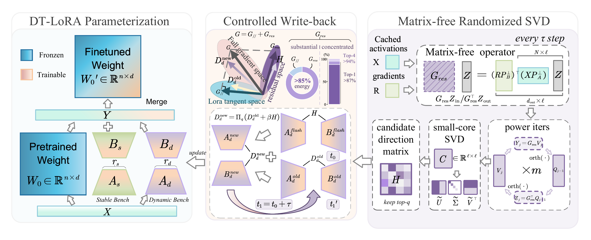
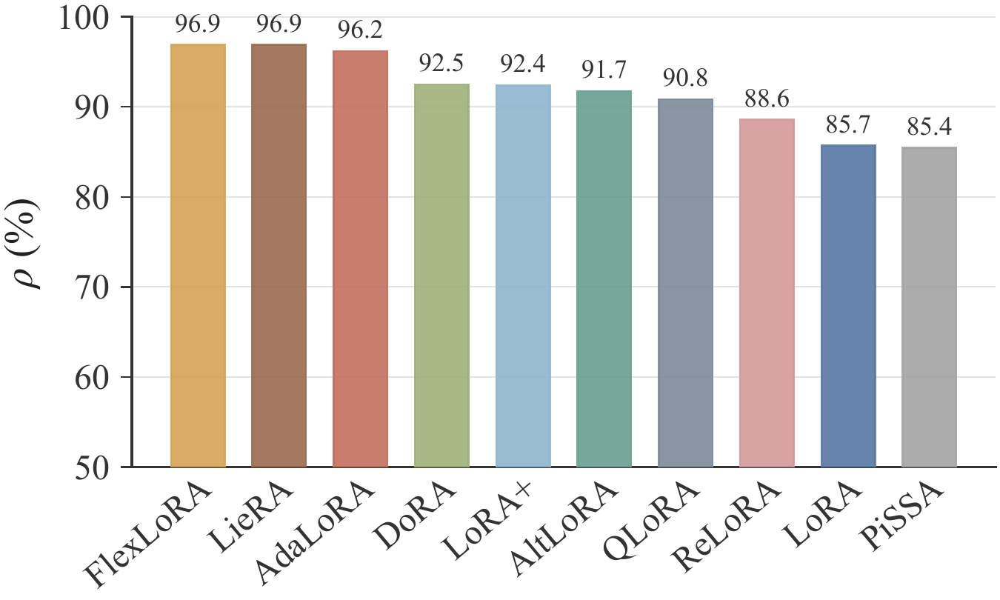
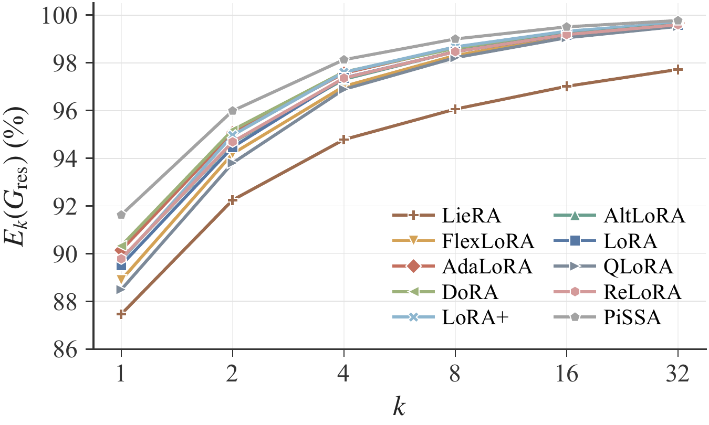
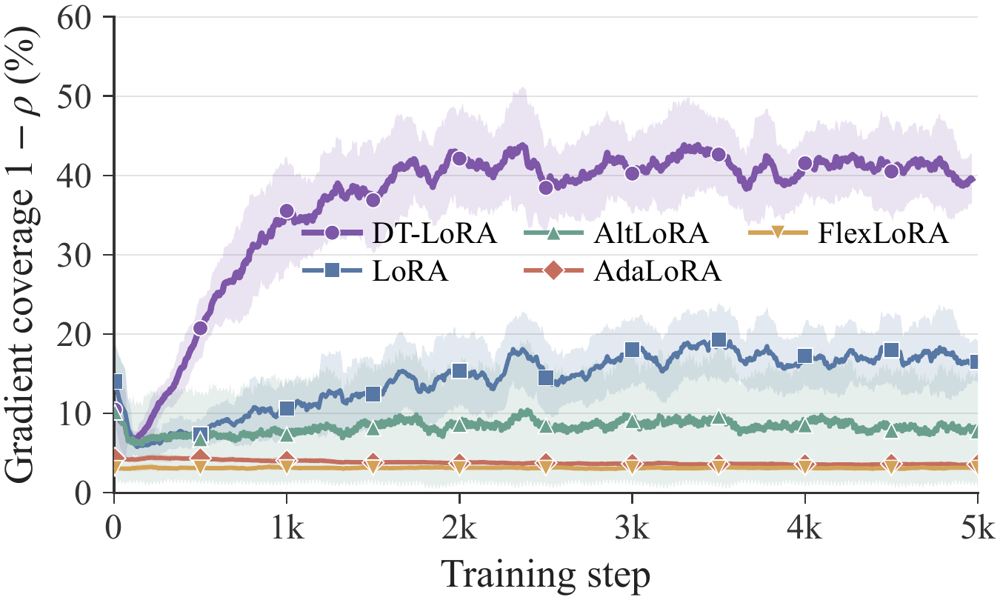

# DT-LoRA: Reaching Beyond the Tangent Space of Low-Rank Adaptation

<!-- TODO: paper link / arXiv badge / venue -->

DT-LoRA splits each low-rank adapter into a **stable** branch and a **dynamic** branch. At a fixed interval, the dynamic branch is re-initialized from the top singular directions of the residual gradient, which lets the adapter move outside the tangent space of its current low-rank factorization. The result is then merged and compressed back into the stable branch. The parameter budget matches LoRA, and the adapter is merged into `W0` after training, so inference has no extra cost.

> **Code status.** The full source code will be released upon acceptance of the paper. Until then this repository contains the paper overview, figures, main results and a cryptographic commitment to the private v1.0.0 code snapshot; see [Code Integrity](#code-integrity).

<p align="center">
  
</p>

## Motivation

<p align="center">
  
  
  
</p>

**Left:** for existing LoRA variants, ρ = 85.4%–96.9% of the gradient lies outside the tangent space of the current low-rank factors. **Middle:** this residual gradient `G_res` is concentrated in a few directions; its top-k energy E<sub>k</sub>(G<sub>res</sub>) is high already at small k. **Right:** gradient coverage 1 − ρ over the first 5k training steps; DT-LoRA reaches into these residual directions, while LoRA-style updates stay in the tangent space.

## Highlights

- **Same parameter count as LoRA, no extra inference cost.** Adapters merge into the base weights after training.
- **Matrix-free refresh.** The top singular directions of the residual gradient `G_res` come from a randomized SVD that only uses matrix-vector products, so `G_res` is never materialized.
- **Controlled write-back.** Merge-and-compress keeps the rank fixed, and a jump constraint bounds how far each refresh moves the weights.
- **Works across vision and language.** We evaluate on VTAB-1K, MS COCO, and open-vocabulary domain-generalized semantic segmentation (OVDG-SS) for vision, and on Commonsense Reasoning and GLUE for language.

## Method

| Component | Paper section | Module |
|---|---|---|
| Stable / dynamic parameterization | §4.1 | `dt_lora/layer.py` |
| Residual gradient and candidate directions | §4.2 | `dt_lora/candidate.py` |
| Matrix-free randomized SVD | §4.3 | `dt_lora/rsvd.py` |
| Merge-and-compress + jump constraint | §4.4 | `dt_lora/writeback.py` |
| Refresh scheduling, optimizer-state reset | §4 / Alg. 1 | `dt_lora/controller.py` |
| Post-training merge into `W0` | — | `dt_lora/merge.py` |

Model-specific adaptations (CLIP fused QKV, timm ViT, HuggingFace LLaMA / DeBERTaV3) live in `dt_lora/integrations/`, separate from the core algorithm.

## Code Release

The code is not public yet. It will be released upon acceptance, together with installation instructions, a quick-start example and the reproduction scripts for every experiment. The released code will match the snapshot committed in [Code Integrity](#code-integrity).

## Experiments

| Task | Backbone | Upstream |
|---|---|---|
| VTAB-1K | ViT-B/16 | ViT_PEFT_Vision |
| MS COCO | ConvNeXt-V2-B | MMDetection |
| OVDG-SS | CLIP | CAT-Seg / PCA-Seg |
| Commonsense Reasoning | LLaMA | LLM-Adapters |
| GLUE | DeBERTaV3-base | HF Transformers (`run_glue.py`) |

## Main Results

**MS COCO**: object detection and instance segmentation with fine-tuned ConvNeXt-V2-B (Mask R-CNN). Det = box AP, Seg = mask AP.

| Method | Params (M) | Det mAP | AP<sub>50</sub> | AP<sub>75</sub> | AP<sub>S</sub> | AP<sub>M</sub> | AP<sub>L</sub> | Seg mAP | AP<sub>50</sub> | AP<sub>75</sub> | AP<sub>S</sub> | AP<sub>M</sub> | AP<sub>L</sub> | All Avg. |
|---|---|---|---|---|---|---|---|---|---|---|---|---|---|---|
| Full FT | 104.97 | 49.0 | 69.1 | 54.6 | 31.7 | 53.5 | 61.7 | 43.4 | 66.2 | 47.6 | 23.4 | 47.1 | 60.9 | 50.7 |
| LoRA (r=16) | 17.27 | 35.5 | 55.9 | 38.9 | 22.7 | 38.4 | 45.1 | 33.6 | 53.1 | 36.3 | 17.4 | 35.9 | 48.2 | 38.4 |
| LieRA | 17.27 | 39.1 | 59.9 | 43.1 | 25.9 | 42.6 | 49.2 | 37.0 | 57.6 | 40.2 | 20.1 | 40.0 | 53.2 | 42.3 |
| DoRA | 17.27 | 39.7 | 60.6 | 43.6 | 25.3 | 43.2 | 51.4 | 37.2 | 57.9 | 40.1 | 19.4 | 40.2 | 53.9 | 42.7 |
| **DT-LoRA** | 17.27 | **44.1** | **65.2** | **48.2** | **28.7** | **47.9** | **56.5** | **40.3** | **62.6** | **43.6** | **21.9** | **43.5** | **57.1** | **46.6** |
| LoRA (r=32) | 34.54 | 35.9 | 56.4 | 39.7 | 22.9 | 39.6 | 45.7 | 34.4 | 54.2 | 37.1 | 18.3 | 36.7 | 48.9 | 39.2 |
| DoRA | 34.54 | 40.3 | 61.1 | 44.2 | 24.1 | 44.0 | 52.2 | 37.4 | 58.4 | 40.6 | 18.5 | 40.2 | 53.6 | 42.9 |
| LieRA | 34.54 | 40.5 | 61.2 | 45.1 | 25.3 | 44.1 | 50.8 | 38.2 | 58.9 | 41.8 | 19.8 | 41.2 | 53.9 | 43.4 |
| **DT-LoRA** | 34.54 | **45.3** | **66.0** | **49.7** | **28.9** | **49.3** | **57.7** | **41.1** | **63.5** | **44.5** | **22.5** | **44.7** | **58.3** | **47.6** |

**OVDG-SS** (Real-to-Real, trained on CS-7, mIoU %). Parentheses give the gain over the base segmentor (CAT-Seg or PCA-Seg) with the same backbone. Bold marks the best value per column.

EVA02 ViT-B/16:

| Method | Train | ACDC-19 | BDD-19 | Mapi-19 | Dv-19 Avg. | ACDC-41 | BDD-41 | Mapi-30 | RW-10 | Dv-58 Avg. |
|---|---|---|---|---|---|---|---|---|---|---|
| OVSeg (CVPR'23) | CS-7 | 36.6 | 40.9 | 45.8 | 41.1 | 41.2 | 48.3 | 31.7 | 32.6 | 38.5 |
| SAN (CVPR'23) | CS-7 | 37.6 | 39.4 | 44.0 | 40.3 | 44.3 | 46.8 | 35.4 | 30.7 | 39.3 |
| CAT-Seg (CVPR'24) | CS-7 | 38.9 | 44.0 | 47.6 | 43.5 | 47.6 | 51.6 | 38.2 | 36.5 | 43.5 |
| MAFT+ (ECCV'24) | CS-7 | 40.4 | 43.5 | 50.2 | 44.7 | 46.4 | 48.8 | 38.1 | 35.4 | 42.2 |
| ESC-Net (CVPR'25) | CS-7 | 40.4 | 43.6 | 45.9 | 43.3 | 47.3 | 49.2 | 40.1 | 34.5 | 42.7 |
| MaskAdapter (CVPR'25) | CS-7 | 38.9 | 47.7 | 49.9 | 45.5 | 48.3 | 51.2 | 39.8 | 36.1 | 43.8 |
| CLIPSelf (ICLR'24) | CS-7+COCO | 43.6 | 45.6 | 47.9 | 45.7 | 49.4 | 54.3 | 39.6 | 36.5 | 45.0 |
| RSC-CLIPSelf (ICLR'25) | CS-7+COCO | 41.5 | 46.3 | 50.2 | 46.0 | 50.0 | 53.0 | 40.1 | 35.1 | 44.5 |
| CAT-Seg + AdvStyle | CS-7 | 37.2 | 43.2 | 44.6 | 41.7 | 48.0 | 47.9 | 36.0 | 36.5 | 42.1 |
| CAT-Seg + DGInStyle | CS-7 | 42.5 | 49.8 | 49.4 | 47.2 | 46.1 | 53.7 | 36.8 | 36.0 | 43.2 |
| LoRA-Pro (CAT-Seg) | CS-7 | 40.7 | 43.7 | 45.7 | 43.3 | 48.5 | 54.9 | 36.6 | 29.0 | 42.2 |
| DoRA (CAT-Seg) | CS-7 | 44.9 | 46.5 | 53.8 | 48.4 | 53.3 | 57.8 | 42.6 | 37.4 | 47.8 |
| SoMA (CAT-Seg) | CS-7 | 44.5 | 46.6 | 53.8 | 48.3 | 52.3 | 57.5 | 42.0 | **39.7** | 47.9 |
| LoRA (CAT-Seg) | CS-7 | 44.2 | 46.5 | 53.2 | 48.0 | 52.7 | 58.2 | 42.4 | **39.7** | 48.3 |
| S²-Corr (CVPR'26) | CS-7 | 44.6 | **50.1** | **56.2** | 50.3 | 52.3 | 58.6 | 42.0 | 38.6 | 47.9 |
| **DT-LoRA (CAT-Seg)** | CS-7 | **48.5** (+9.6) | 48.6 (+4.6) | **56.2** (+8.6) | **51.1** (+7.6) | **55.3** (+7.7) | **59.5** (+7.9) | **44.1** (+5.9) | 39.0 (+2.5) | **49.5** (+6.0) |

EVA02 ViT-L/14:

| Method | Train | ACDC-19 | BDD-19 | Mapi-19 | Dv-19 Avg. | ACDC-41 | BDD-41 | Mapi-30 | RW-10 | Dv-58 Avg. |
|---|---|---|---|---|---|---|---|---|---|---|
| CAT-Seg (CVPR'24) | CS-7 | 48.5 | 48.5 | 50.8 | 49.3 | 59.2 | 60.0 | 41.1 | 39.5 | 50.0 |
| MaskAdapter (CVPR'25) | CS-7 | 48.1 | 49.4 | 54.6 | 50.7 | 59.7 | 59.7 | 41.8 | 36.1 | 49.3 |
| CLIPSelf (ICLR'24) | CS-7+COCO | 51.1 | 53.0 | 55.7 | 53.3 | 61.3 | 60.3 | 44.7 | 39.8 | 51.5 |
| CAT-Seg + DGInStyle | CS-7 | 50.4 | 51.7 | 50.4 | 50.8 | 60.2 | 60.8 | 43.5 | 38.7 | 50.8 |
| LoRA-Pro (CAT-Seg) | CS-7 | 42.2 | 44.5 | 47.5 | 44.7 | 49.1 | 53.5 | 38.7 | 30.0 | 42.8 |
| LoRA (CAT-Seg) | CS-7 | 51.2 | 50.9 | 55.7 | 52.6 | 53.6 | 54.1 | 44.2 | 43.9 | 49.0 |
| SoMA (CAT-Seg) | CS-7 | 48.5 | 48.7 | 50.7 | 49.3 | 52.3 | 56.6 | 41.3 | 40.0 | 47.5 |
| PCA-Seg (CVPR'26) | CS-7 | 53.8 | 53.7 | 57.5 | 55.0 | 60.9 | 60.3 | 50.3 | 39.0 | 52.6 |
| S²-Corr (CVPR'26) | CS-7 | 54.3 | 53.1 | 60.0 | 55.8 | 62.0 | 61.7 | 47.4 | 41.9 | 53.2 |
| DoRA (CAT-Seg) | CS-7 | 55.7 | 55.6 | 59.9 | 57.1 | 62.3 | 61.5 | 50.3 | 44.1 | 54.6 |
| **DT-LoRA (PCA-Seg)** | CS-7 | 55.8 (+2.0) | 55.8 (+2.1) | 60.5 (+3.0) | 57.4 (+2.4) | 61.0 (+0.1) | 61.1 (+0.8) | 50.6 (+0.3) | **47.9** (+8.9) | 55.2 (+2.6) |
| **DT-LoRA (CAT-Seg)** | CS-7 | **58.9** (+10.4) | **57.3** (+8.8) | **61.5** (+10.7) | **59.2** (+9.9) | **63.8** (+4.6) | **64.3** (+4.3) | **51.7** (+10.6) | 44.5 (+5.0) | **56.1** (+6.1) |

Results on VTAB-1K, commonsense reasoning and GLUE are reported in the paper.

## Project Structure

Layout of the private v1.0.0 snapshot (to be released):

```
DT-LoRA/
├── dt_lora/                    # core implementation
│   ├── config.py            
│   ├── layer.py              
│   ├── inject.py              
│   ├── candidate.py          
│   ├── rsvd.py            
│   ├── writeback.py         
│   ├── controller.py        
│   ├── linalg.py              
│   ├── merge.py              
│   └── integrations/           # model-specific bridges, separate from the core
├── experiments/                # per-task reproduction code
│   ├── vtab/                
│   ├── coco/                 
│   ├── ovdg_ss/               
│   ├── glue/                  
│   └── commonsense/          
├── tests/                      # unit tests: probe accumulation, candidate / merge references, DDP refresh
│   └── benchmarks/          
└── assets/                     # figures
```

## Code Integrity

The private code snapshot was archived on 2026-10-11 with `git archive --format=tar --prefix=DT-LoRA/` on Linux (commit `9637ac432e19e3b65d722c2ef63bf7f5ee276683`, version 1.0.0). Its SHA-256 digest is

```
b2ae2252e5815bf5cbbb1848f15889d4448700b0a2c2a6e2956e33e803889ce7  DT-LoRA-v1.0.0-9637ac4.tar
```

| File | Content |
|---|---|
| [`integrity/DT-LoRA-v1.0.0-9637ac4.tar.sha256`](integrity/DT-LoRA-v1.0.0-9637ac4.tar.sha256) | SHA-256 of the archive (6,912,000 bytes, 408 entries) |
| [`integrity/DT-LoRA-v1.0.0-9637ac4.tar.ots`](integrity/DT-LoRA-v1.0.0-9637ac4.tar.ots) | [OpenTimestamps](https://opentimestamps.org) proof anchoring the digest in the Bitcoin blockchain |

When the code is released, the exact archive will be published alongside it. To verify:

```bash
sha256sum -c integrity/DT-LoRA-v1.0.0-9637ac4.tar.sha256   # archive matches the committed digest
ots verify integrity/DT-LoRA-v1.0.0-9637ac4.tar.ots         # digest existed at the attested time
```

Re-running `git archive` on another machine can produce different bytes (line-ending conversion, git version), so verification uses the published archive itself.

## Citation

The paper is in preparation for submission. A BibTeX entry will be added here once it is publicly available.

## Acknowledgements

This project builds on [ViT_PEFT_Vision](https://github.com/OSU-MLB/ViT_PEFT_Vision), [S²-Corr](https://github.com/DZhaoXd/s2_corr), [CAT-Seg](https://github.com/KU-CVLAB/CAT-Seg), [MMDetection](https://github.com/open-mmlab/mmdetection), [LLM-Adapters](https://github.com/AGI-Edgerunners/LLM-Adapters), [HuggingFace Transformers](https://github.com/huggingface/transformers), and [Subspace-Tuning](https://github.com/Chongjie-Si/Subspace-Tuning) (FlexLoRA / LoRA baselines on GLUE). We thank the authors for releasing their code.

## License

Released under the [Apache-2.0 License](LICENSE). Once the code is released, code adapted from third-party projects keeps its original license; see the corresponding `experiments/<task>/` folder.
